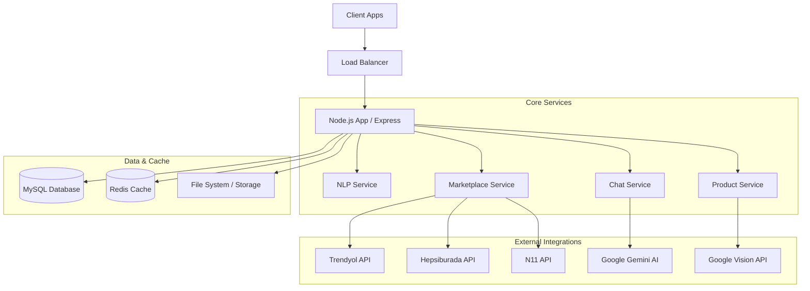
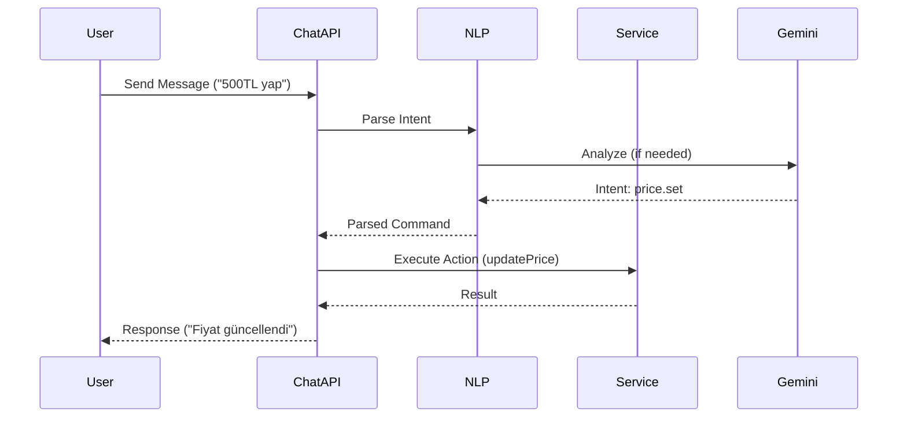
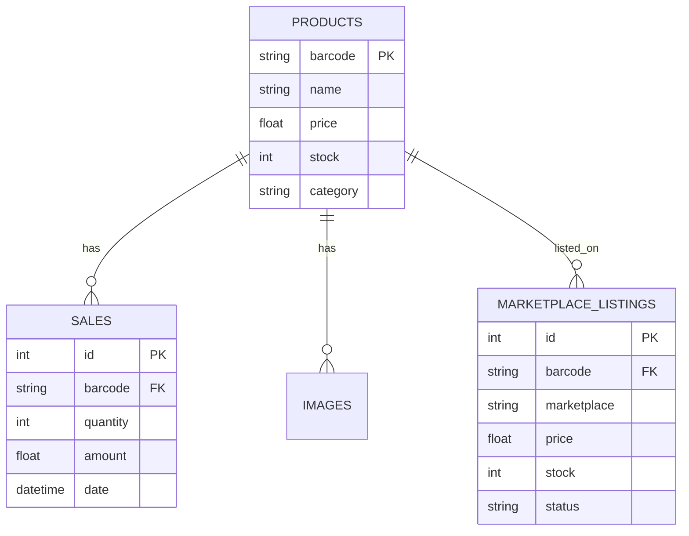

# System Architecture

## Overview

Beekod Chatbot is an e-commerce management system that integrates with multiple marketplaces (Trendyol, Hepsiburada, N11) and provides a chat-based interface for operations.

## High-Level Architecture

## Data Flow: Chat Interaction

## Database Schema Overview

## Directory Structure

- `src/services`: Core logic (NLP, Pricing, Products)
- `src/marketplaces`: Provider adapters for external APIs
- `src/routes`: API endpoints
- `src/models`: Database types and schemas
- `scripts`: Utility and maintenance scripts
